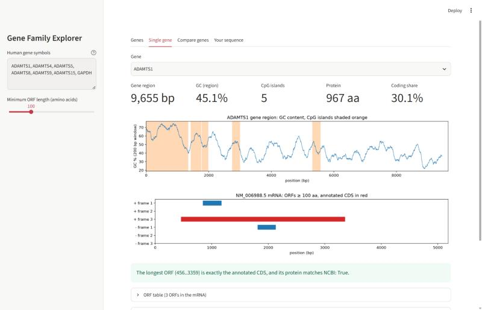
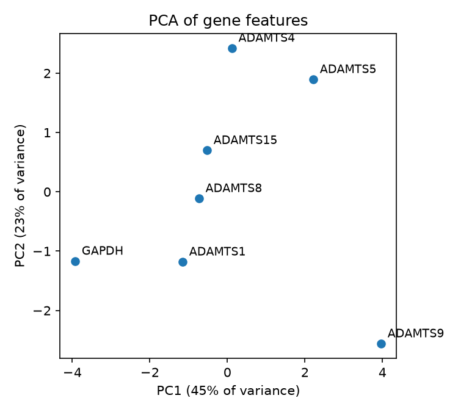
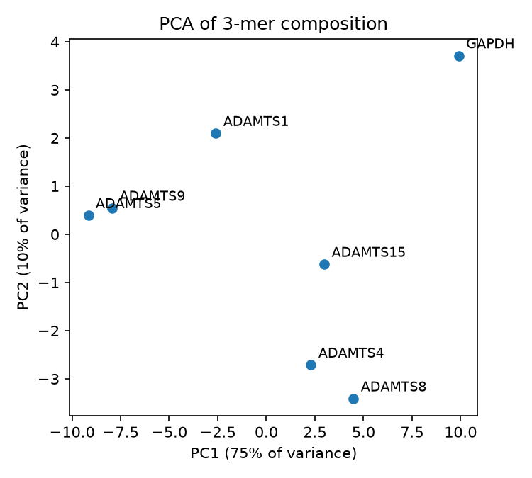
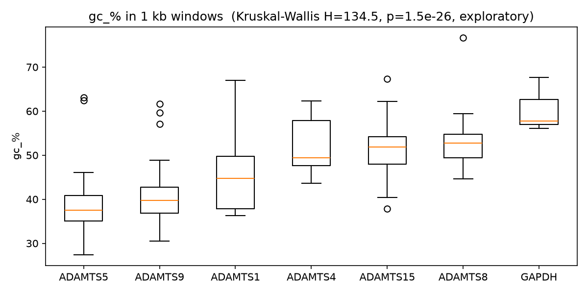

# Gene Family Explorer

A Streamlit app that pulls human genes from NCBI, finds their open reading frames (ORFs) and CpG islands, and compares the genes side by side. The default set is the ADAMTS family of extracellular proteases (ADAMTS1, 4, 5, 8, 9, 15), with GAPDH as an unrelated outgroup. Any human gene symbol works.



## What it does

| Tab | Shows |
|---|---|
| **Genes** | Each gene's RefSeq Select mRNA, genomic location and lengths |
| **Single gene** | Sliding-window GC with CpG islands shaded; six-frame ORF map of the mRNA with the annotated CDS in red; ORF and island tables |
| **Compare genes** | Feature heatmap, PCA of gene features, PCA of 3-mer composition, GC / CpG in 1 kb windows with a Kruskal-Wallis test |
| **Your sequence** | Upload or paste any FASTA: GC, CpG islands, ORFs, reverse complement, translation |

## How it's built

```
sequence.py   core DNA functions, pure Python: FASTA parsing, GC, reverse complement,
              translation, six-frame ORFs, CpG islands (O(n) prefix sums), k-mers
ncbi.py       fetch_gene(symbol): mRNA + genomic region from NCBI E-utilities, cached in data/
compare.py    gene x feature table, k-mer table, PCA (SVD), windowed statistics, charts
app.py        Streamlit interface only; all analysis comes from the modules above
```

The analysis is written by hand. Biopython is used to check it, not to do it:

- `test_sequence.py` checks reverse complement, transcription, translation, GC content and the ORF finder against Biopython on random sequences, and the CpG island finder against a brute-force version.
- `test_compare.py` runs the comparison on synthetic AT-rich and GC-rich genes, which PCA has to separate.
- `check_adamts5.py [GENE]` checks real data: the longest ORF in the mRNA must equal NCBI's annotated CDS, base for base, with an identical protein. This held for all 10 genes tried: ADAMTS1, 4, 5, 8, 9, 15, ACTB, TP53, GAPDH and BRCA1.

## Findings


- **ORFs belong in the mRNA, not the gene region.** ADAMTS5's gene region is 49 kb, but only 5.7% of it codes for protein. The longest ORF in that region is 379 aa, while the real protein is 930 aa split across exons. In the mRNA, the longest ORF is the CDS exactly.
- **Composition follows genomic neighborhood more than family history.** In the 3-mer PCA, ADAMTS8 and ADAMTS15 land together; they sit about 20 kb apart on chromosome 11 and share about 80% GC at third codon positions. ADAMTS5 and ADAMTS9 group together as the AT-rich, intron-heavy genes. ADAMTS1 and ADAMTS5 are also neighbors (chromosome 21) but don't group, so neighborhood isn't the whole story.
- **Most genes start in a CpG island; ADAMTS4 doesn't.** Six of the seven genes have an island within 2 kb of their 5' end. ADAMTS4's first island is 7.7 kb in.

| PCA of gene features | PCA of 3-mer composition |
|---|---|
|  |  |



**A note on the statistics:** with 7 genes, tests on gene-level averages have little power, so the app compares 1 kb windows instead. Neighboring windows are correlated, which makes the Kruskal-Wallis p-value too optimistic. Read it as "these distributions look different", not as proof.

## Run it

```bash
pip install -r requirements.txt
streamlit run app.py
```

Checks: `python test_sequence.py`, `python test_compare.py`, `python check_adamts5.py`. To regenerate the figures, run `python compare.py`.

Gene data is downloaded from NCBI the first time a gene is used and is then read from `data/`. Commit `data/` so the default genes load instantly in a deployed copy.

## Deploy (free)

1. Push this folder to a public GitHub repository.
2. On [share.streamlit.io](https://share.streamlit.io), choose **New app**, pick the repository, and set the main file to `app.py`.

## Limits

- Human genes only, using one transcript per gene (RefSeq Select).
- The ORF finder uses ATG starts and the standard genetic code, and doesn't report nested ORFs.
- CpG islands use the Gardiner-Garden & Frommer thresholds (200 bp, GC ≥ 50%, obs/exp ≥ 0.6). The stricter Takai-Jones settings are available as function arguments.
