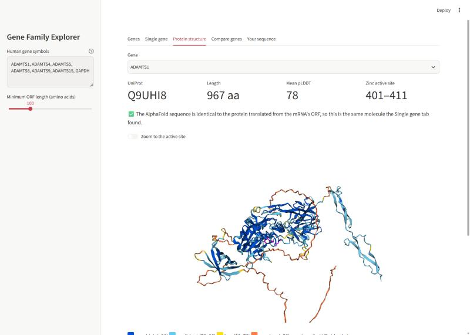
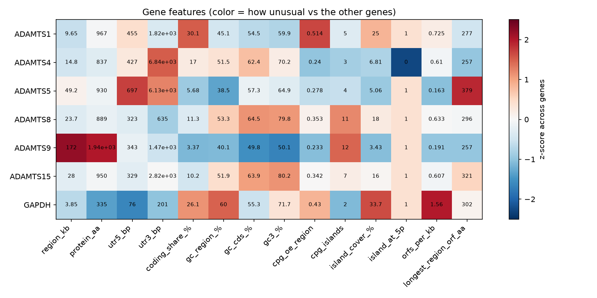
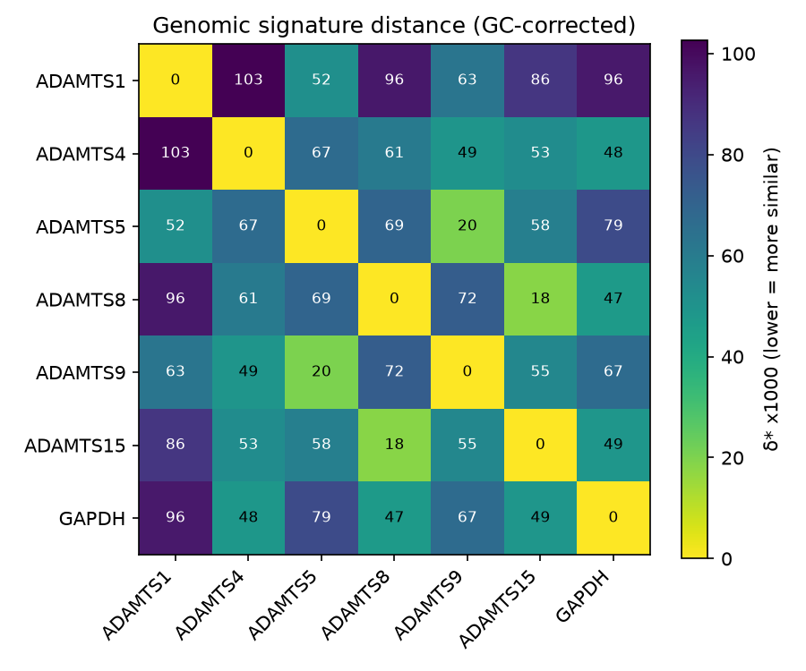

# Gene Family Explorer

**Live app: [genefamilytkthang.streamlit.app](https://genefamilytkthang.streamlit.app/)**

A Streamlit app that follows human genes from DNA to protein structure. It pulls each gene from NCBI, finds its open reading frames (ORFs) and CpG islands, shows the protein's AlphaFold structure with its active site, and compares the genes side by side. The default set is the ADAMTS family of extracellular proteases (ADAMTS1, 4, 5, 8, 9, 15), with GAPDH as an unrelated outgroup. Any human gene symbol works.


## What it does

| Tab | Shows |
|---|---|
| **Genes** | Each gene's RefSeq Select mRNA, genomic location and lengths |
| **Single gene** | Interactive (zoom, pan, hover) sliding-window GC with CpG islands; six-frame ORF map of the mRNA with the annotated CDS in red; ORF and island tables |
| **Protein structure** | The AlphaFold model in 3D, colored by prediction confidence, with the zinc active site's histidines and glutamate as sticks; confidence along the protein |
| **Compare genes** | Feature heatmap, GC-corrected genomic signature distances, PCA of gene features, GC / CpG in 1 kb windows with a Kruskal-Wallis test |
| **Your sequence** | Upload or paste any FASTA: GC, CpG islands, ORFs, reverse complement, translation |



## How it's built

```
sequence.py   core DNA functions, pure Python: FASTA parsing, GC, reverse complement,
              translation, six-frame ORFs, CpG islands (O(n) prefix sums),
              dinucleotide relative abundance (Karlin's genomic signature), k-mers
ncbi.py       fetch_gene(symbol): mRNA + genomic region from NCBI E-utilities, cached in data/
structure.py  fetch_structure(symbol): UniProt entry -> AlphaFold model, cached in data/;
              per-residue confidence (pLDDT); zinc active-site motif search
compare.py    gene x feature table, genomic signature distance, PCA (SVD), windowed statistics, charts
app.py        Streamlit interface only (Altair for interactive tracks, py3Dmol for 3D);
              all analysis comes from the modules above
```

Everything runs on one chain, and each link is checked: mRNA → longest ORF → protein → AlphaFold structure → active site. For all six ADAMTS genes, the protein translated from the mRNA's longest ORF is identical to the AlphaFold model's sequence.

The analysis is written by hand. Biopython is used to check it, not to do it:

- `test_sequence.py` checks reverse complement, transcription, translation, GC content and the ORF finder against Biopython on random sequences. It also checks the CpG island finder against a brute-force version, and tests that the genomic signature stays flat for random DNA even at 75% GC.
- `test_compare.py` runs the comparison on synthetic AT-rich and GC-rich genes.
- `test_structure.py` checks the motif search and the confidence-score parsing offline.
- `check_adamts5.py [GENE]` checks real data: the longest ORF in the mRNA must equal NCBI's annotated CDS, base for base, with an identical protein. This held for all 10 genes tried: ADAMTS1, 4, 5, 8, 9, 15, ACTB, TP53, GAPDH and BRCA1.

## Findings



- **ORFs belong in the mRNA, not the gene region.** ADAMTS5's gene region is 49 kb, but only 5.7% of it codes for protein. The longest ORF in that region is 379 aa, while the real protein is 930 aa split across exons. In the mRNA, the longest ORF is the CDS exactly.
- **Two gene pairs share a genomic signature even after GC content is removed.** Raw 3-mer composition turned out to be almost entirely GC content: its first principal component correlated with GC at r = 0.999, so it was replaced. Karlin's dinucleotide signature divides out base composition, and on it two pairs stay far closer than any others (δ* = 18 and 20, against 47–103 for every other pair):
  - **ADAMTS8 and ADAMTS15**, which sit about 20 kb apart on chromosome 11;
  - **ADAMTS5 and ADAMTS9**, the two AT-rich genes with very long introns.

  ADAMTS1 and ADAMTS5 are also neighbors on chromosome 21, yet they aren't close (δ* = 52), so genomic neighborhood isn't the whole story.
- **Every ADAMTS protease has the zinc active site, and AlphaFold is most confident there.** The pattern HExxH.....H appears exactly once in each of the six ADAMTS proteins (residues 361–444) and not at all in GAPDH. The textbook motif HExxHxxGxxH also requires a glycine at position 8, but only ADAMTS5 has it; the other five read HELGHVFNMPH or close to it. Mean confidence (pLDDT) across the active site is 92–97, while the first 200 residues average only 54–60. Those first residues are likely the signal peptide and prodomain, the parts trimmed off before the enzyme becomes active.
- **Most genes start in a CpG island; ADAMTS4 doesn't.** Six of the seven genes have an island within 2 kb of their 5' end. ADAMTS4's first island is 7.7 kb in.

| Genomic signature distance (GC-corrected) | PCA of gene features |
|---|---|
|  |  |


**A note on the statistics:** with 7 genes, tests on gene-level averages have little power, so the app compares 1 kb windows instead. Neighboring windows are correlated, which makes the Kruskal-Wallis p-value too optimistic. Read it as "these distributions look different", not as proof. For the same reason, the PCA of gene features is best read as a summary of the heatmap, not as evidence of clusters.

## Run it

```bash
pip install -r requirements.txt
streamlit run app.py
```

Checks: `python test_sequence.py`, `python test_compare.py`, `python test_structure.py`, `python check_adamts5.py`. To regenerate the figures, run `python compare.py`. To print the active site for any genes, run `python structure.py ADAMTS1 GAPDH`.

Gene and structure data are downloaded the first time a gene is used, then read from `data/`. Commit `data/` so the default genes load instantly in a deployed copy.

## Deploy (free)

1. Push this folder to a public GitHub repository.
2. On [share.streamlit.io](https://share.streamlit.io), choose **New app**, pick the repository, and set the main file to `app.py`.

## Limits

- Human genes only, using one transcript per gene (RefSeq Select). The structure is UniProt's canonical isoform, and the app warns if it differs from the RefSeq protein.
- The ORF finder uses ATG starts and the standard genetic code, and doesn't report nested ORFs.
- CpG islands use the Gardiner-Garden & Frommer thresholds (200 bp, GC ≥ 50%, obs/exp ≥ 0.6). The stricter Takai-Jones settings are available as function arguments.
- AlphaFold models are predictions. Low-confidence regions (orange) shouldn't be read as real structure.
